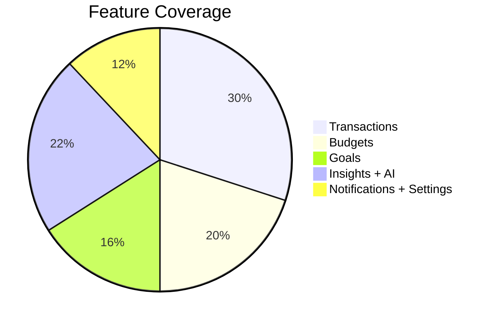
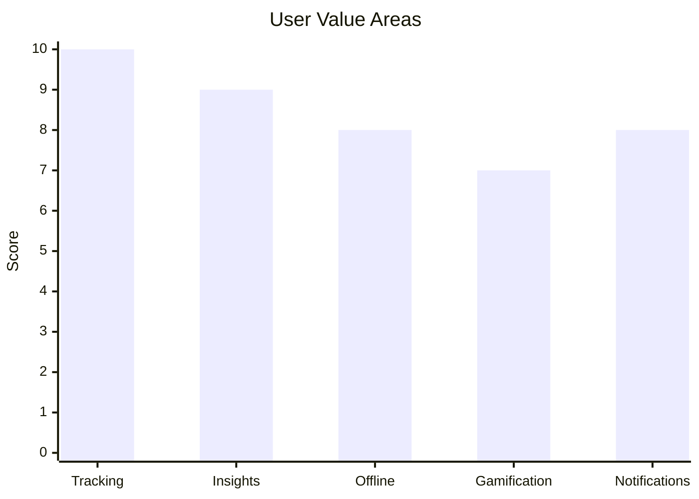

<div align="center">


# Zorvyn

</div>

Zorvyn is a Flutter personal finance app focused on fast tracking, offline-friendly data, AI insights, and a polished mobile experience.

## Highlights

- Track income, expenses, budgets, goals, and challenges in one app.
- Works with a live backend plus local cache for better offline behavior.
- Supports push notifications, onboarding, AI chat, leaderboard, and dark mode.
- Uses the branded Zorvyn logo for splash and in-app identity.

## Product Snapshot





## Core Modules

| Module | What it does |
| --- | --- |
| Dashboard | Summary cards, quick actions, recent transactions |
| Transactions | Add, edit, delete, filter, and inspect records |
| Budgets | Category-based spending limits with progress states |
| Goals | Savings targets and progress tracking |
| Insights | Spending patterns, trends, and health signals |
| AI | Chat, spending analysis, prediction, optimization |
| Notifications | FCM, local notifications, in-app inbox |
| Settings | Theme, profile, legal pages, and support |

## Architecture

```text
Flutter UI
  -> Riverpod providers
  -> Services layer
  -> REST API / local storage / SQLite cache / Firebase Messaging
```

Key folders:

- `lib/config`: routing, theming, constants, exceptions
- `lib/models`: typed app models
- `lib/providers`: Riverpod state and async orchestration
- `lib/screens`: feature screens
- `lib/services`: API, storage, database, connectivity, notifications
- `lib/widgets`: reusable UI pieces

## Setup

```bash
flutter pub get
flutter run
```

Android release build:

```bash
flutter build apk --release
```

## Notes

- Android Firebase config is included through `android/app/google-services.json`.
- Splash and in-app branding now use `logo_light.png` and `logo_dark.png`.
- Notification permission is requested from the splash flow for a cleaner first-run experience.
